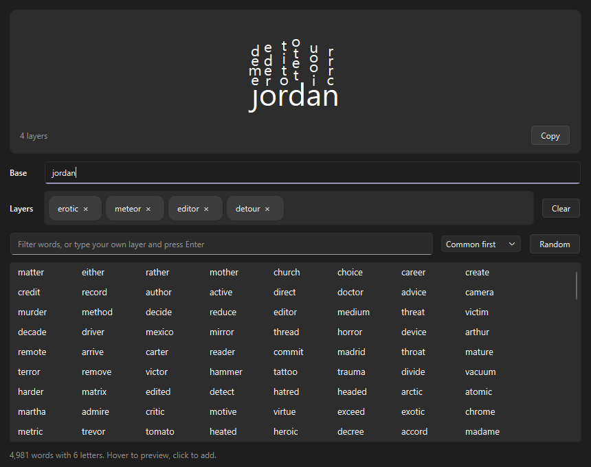

# Diacritical Characters

Stack tiny words on top of other words using Unicode combining letters, like
`tͭͫͩrͣͣͤyͨͭͫpͪͪͦoͦͤͨgͫͫͬrͤͣͣaͭͭͭpͤͥͥhͬͨͨ`. The output is plain text, so it pastes anywhere
that renders Unicode.



## How it works

Unicode's original block of combining superscript letters covers 13 Latin
letters: `a c d e h i m o r t u v x`. A word can sit on top of your base text if
it is the same length and uses only those letters. The app ships with about
29,000 such words, ranked most common first, and shows the ones that fit.

Unicode later added 10 more: `b f g k l n p s w z` (only j, q and y have no
combining form). Far fewer fonts support these, so they often show up as boxes
or in the wrong spot, especially on phones. They're off by default; tick
**More letters** to use them. The app warns you first and shows a sample so you
can see how your device draws them. With them on, the list grows to about
129,000 words.

## Use it

**In the browser:** <https://gabekao.github.io/Diacritical-Characters/>. Nothing
to install, and it works on phones.

**As a desktop app:** grab the latest Windows zip from
[Releases](https://github.com/gabekao/Diacritical-Characters/releases), unzip
it, and run `DiacriticalCharacters.exe`. Nothing else to install or download.

There is also a command line tool; see [Run from source](#run-from-source).

## Using the app

1. Type your base text.
2. Hover a word to preview it; click it to add it as a layer. Stack as many as you like.
3. Type in the filter box to narrow the list. Enter adds the top match, or
   whatever you typed if it is a valid layer of its own.
4. Click a layer chip to remove it, then hit **Copy**.
5. Optional: tick **More letters** for the 10 extra letters (see above).

## Run from source

```powershell
python -m venv .venv
.venv\Scripts\Activate.ps1
pip install -r requirements.txt
python gui.py
```

Command line version:

```powershell
python string_maker.py --base typography --superscript decorative --superscript attractive
```

Add `--extended` to allow the 10 extra letters.

Tests:

```powershell
python -m unittest discover -s tests
```

## Build the executable

```powershell
pip install pyinstaller
pyinstaller --noconfirm --clean DiacriticalCharacters.spec
```

The result is in `dist\DiacriticalCharacters\`. The **Release GUI EXE** GitHub
Actions workflow does the same thing and publishes the zip.

## Web app

The site is three static files in `web/` with no backend and no build step;
everything runs in the browser. It reads the same word list as the desktop app.
To try it locally, serve the repository root and open `/web/`:

```powershell
python -m http.server 8000
```

Then visit <http://localhost:8000/web/>. The **Deploy web app** workflow
publishes it to GitHub Pages on every push to `master` that touches `web/` or
the word list.

## Regenerating the word list

You only need this to change which words are suggested. The lists in
`src/diacritical_characters/data/` are distilled from a much larger
corpus (Hunspell, NLTK, wordfreq, Wiktionary, and web frequency lists) that is
built into a local SQLite database:

```powershell
pip install -e .
python -m diacritical_characters.corpus build
python -m diacritical_characters.corpus export-wordlist
```

The build downloads several gigabytes and takes a while. `python setup.py`
runs the same build with a progress window; `python setup.py --help` lists the
options (choosing sources, worker count, full rebuilds).

## Project layout

- `web/`: the browser app (plain HTML, CSS and JavaScript).
- `src/diacritical_characters/gui.py`: the PySide6 desktop app.
- `src/diacritical_characters/core.py`: the letter mapping and string composition.
- `src/diacritical_characters/wordlist.py`: loads and filters the bundled word list.
- `src/diacritical_characters/data/words.txt`: the word list both apps share.
- `src/diacritical_characters/data/words_extended.txt`: the same words plus the
  100,000 most common words that need one of the extra letters, used when
  **More letters** is on.
- `src/diacritical_characters/corpus.py`: the corpus build pipeline (development only).
- `DiacriticalCharacters.spec`: PyInstaller recipe.
